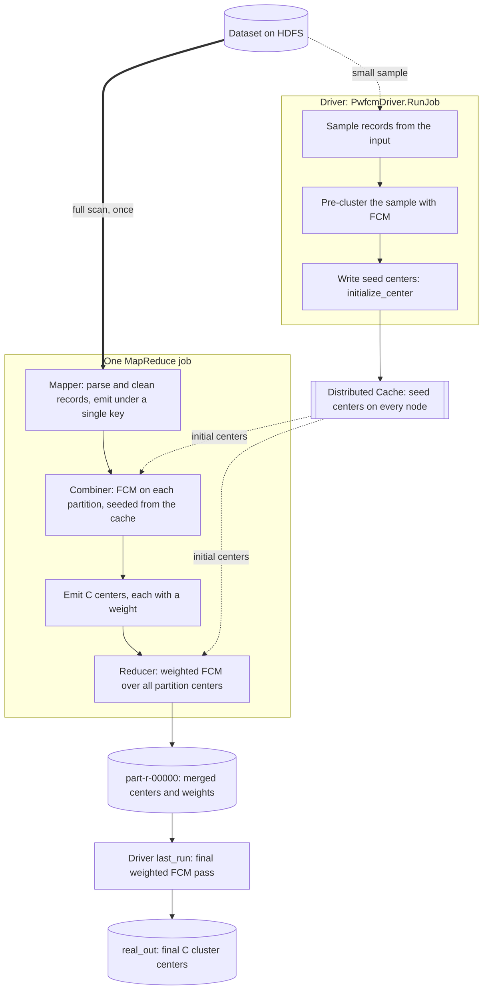

# BigFCM

Scalable Fuzzy C-Means (FCM) clustering on Hadoop MapReduce.

BigFCM clusters very large datasets with fuzzy memberships while running as **one** MapReduce job, instead of one job per FCM iteration. In the evaluation reported in the paper it was about 18x faster than Apache Mahout Fuzzy K-Means on average (5x to 44x across datasets), and up to 493x faster in the best configuration, with comparable clustering quality.

This repository holds the Java implementation (`src/bigfcm`) and the evaluation harness used to compare it with Mahout K-Means and Fuzzy K-Means (`src/evaluation`).

> Fuzzy clustering background: [Wikipedia](https://en.wikipedia.org/wiki/Fuzzy_clustering)

## Why it is different

Classic distributed FCM re-reads and re-shuffles the whole dataset on every iteration. BigFCM avoids that:

| Idea | What it buys you |
|---|---|
| **Seed from a small sample.** The driver pre-clusters a few records and ships the resulting centers to every node through Hadoop's Distributed Cache. | Starts close to the answer, so far fewer iterations are needed than with random seeds. |
| **Cluster inside the combiner.** Each map-side partition runs FCM locally, starting from the cached seeds. | The data is read once and no data moves between nodes during iterations. |
| **Ship centers, not records.** A combiner emits only `C` centers plus one weight per center. | The reducer receives kilobytes instead of gigabytes. |
| **Weight the partial results.** A center's weight is the total membership mass behind it. | The merge step knows which partition-level centers matter more, which protects accuracy. |
| **Weighted FCM to merge.** The reducer runs weighted FCM over all centers. | The final centers reflect the *entire* dataset, not a sample. |
| **A cheaper update step.** The partition-level update never materialises the membership matrix. | Cost per pass is O(n·C) rather than O(n·C²). |

See [docs/how-it-works.md](docs/how-it-works.md) for the details.

## Workflow



## Repository layout

```
src/
  bigfcm/        PwfcmDriver, PwfcmMapper, PwfcmCombiner, PwfcmReducer
  evaluation/    FrameWork: benchmark harness vs Mahout K-Means / Fuzzy K-Means
docs/
  how-it-works.md   algorithm walkthrough mapped onto the code
  usage.md          build, run and argument reference
```

(`PWFCM` is the internal name of the parallel weighted FCM implementation.)

## Quick start

Build and run instructions, with every command-line argument, are in [docs/usage.md](docs/usage.md). In short:

```bash
hadoop jar bigfcm.jar PwfcmDriver <input> <output> <C> <dims> <epsilon> <m> <separator> <sample-size> <max-iter>
```

## Paper

Ghadiri, N., Ghaffari, M., Nikbakht, M.A.: *BigFCM: Fast, precise and scalable FCM on Hadoop.* Future Generation Computer Systems 77 (2017) 29-39.
[Publisher page (DOI)](https://doi.org/10.1016/j.future.2017.06.010) | [ScienceDirect](https://www.sciencedirect.com/science/article/pii/S0167739X17312359) | [arXiv preprint](https://arxiv.org/abs/1605.03047)

The paper contains the full description, experimental setup, tables and figures. The documents here are an independent, shorter guide to the code, not a reproduction of the paper.

If you use this work, please cite:

```bibtex
@article{ghadiri2017bigfcm,
  title   = {BigFCM: Fast, precise and scalable FCM on Hadoop},
  author  = {Ghadiri, Nasser and Ghaffari, Meysam and Nikbakht, Mohammad Amin},
  journal = {Future Generation Computer Systems},
  volume  = {77},
  pages   = {29--39},
  year    = {2017},
  doi     = {10.1016/j.future.2017.06.010}
}
```

## License and copyright

- **Code** in this repository is released under the [GNU GPL v3](LICENSE).
- **The published paper** remains under the copyright of its publisher (Elsevier B.V., 2017). It is not included in this repository, and nothing here reproduces its text, figures or tables. Please use the links above to read it.
- **The documentation** in this repository is original explanatory text written for this project.
