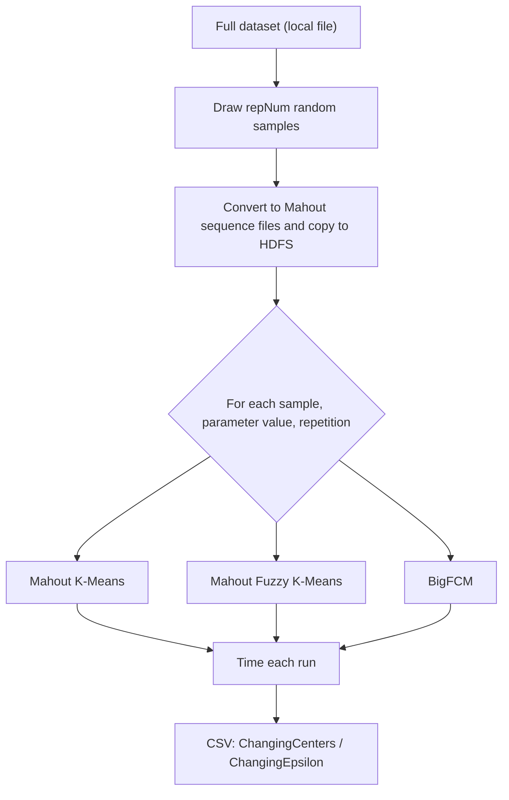

# Build and usage

## Requirements

- Hadoop 2.x with HDFS and YARN. The paper's experiments used Hadoop 2.7.1.
- A JDK compatible with your Hadoop version.
- For `src/evaluation` only: Apache Mahout (the K-Means and Fuzzy K-Means drivers and the `mahout-math`/`mahout-integration` classes it imports).

No build file is provided. The classes are in the default Java package.

## Build

```bash
mkdir -p build
javac -cp "$(hadoop classpath)" -d build src/bigfcm/*.java
jar cf bigfcm.jar -C build .
```

For the evaluation harness, add the Mahout jars to the classpath and compile everything together:

```bash
javac -cp "$(hadoop classpath):/path/to/mahout/*" -d build src/bigfcm/*.java src/evaluation/*.java
```

## Run BigFCM

```bash
hadoop jar bigfcm.jar PwfcmDriver \
  <input> <output> <C> <dims> <epsilon> <m> <separator> <sample-size> <max-iter>
```

| # | Argument | Meaning |
|---|---|---|
| 1 | `input` | HDFS directory with the data files |
| 2 | `output` | HDFS output directory (must not exist) |
| 3 | `C` | Number of clusters |
| 4 | `dims` | Number of numeric fields per record |
| 5 | `epsilon` | Convergence threshold (max change of any center coordinate) |
| 6 | `m` | Fuzziness exponent, greater than 1 (2 is typical) |
| 7 | `separator` | Field separator for the mapper (a regex, as passed to `String.split`) |
| 8 | `sample-size` | Number of records for the pre-clustering step |
| 9 | `max-iter` | Maximum iterations per FCM run |

Records with a different number of fields than `dims` are skipped.

### Input

One record per line, `dims` numeric fields. The pre-clustering sampler expects comma-separated values (see [implementation notes](how-it-works.md#implementation-notes)), so a comma separator is the safe choice.

### Output

| Path | Content |
|---|---|
| `<output>/part-r-00000` | Weighted centers from the reducer |
| `<output>/real_out` | Final `C` centers, one per line, space-separated |
| `/usr/local/hadoop/sample/initialize_center` | Seed centers written by the driver (hard-coded path) |

## Run the evaluation harness

`FrameWork` samples a dataset, converts it to Mahout sequence files, then times Mahout K-Means, Mahout Fuzzy K-Means and BigFCM on the same samples. It writes CSV timing results.

```bash
hadoop jar bigfcm.jar FrameWork <args...>
```

| # | Argument | Meaning |
|---|---|---|
| 1 | `DataSetPath` | Local path of the full dataset (comma-separated) |
| 2 | `NumOFInstance` | Records per generated sample |
| 3 | `repNum` | Number of independent samples |
| 4 | `SampleDirPath` | Local directory for samples and result CSVs (include trailing `/`) |
| 5 | `dimensionInput` | Fields per record |
| 6 | `centers_num_str` | Number of clusters for the epsilon sweep |
| 7 | `Epsilon_str` | Epsilon for the cluster-count sweep |
| 8 | `fuzziness_str` | Fuzziness exponent for BigFCM |
| 9 | `Seperator_str` | Field separator |
| 10 | `num_of_instance` | Pre-clustering sample size passed to BigFCM |
| 11 | `iterations_str` | Maximum iterations |
| 12 | `repeatPerEachSamples` | Repetitions per sample |
| 13 | `EpsilonPath` | Text file, one epsilon per line |
| 14 | `CentersPath` | Text file, one cluster count per line |

Outputs, in `SampleDirPath`:

- `finalResult-ChangingCenters.csv`: timings while varying the number of clusters;
- `finalResult-ChangingEpsilon.csv`: timings while varying epsilon.

Each row is `algorithm,sampleIndex,repetition,clusters,epsilon,milliseconds`.



## Reported results (from the paper)

For context only; see the paper for the experimental setup, tables and figures.

- Datasets: SUSY (5M records), HIGGS (11M records), KDD Cup 99, on Hadoop 2.7.1 clusters of 3 and 9 nodes.
- BigFCM was 5.35x to 44x faster than Mahout Fuzzy K-Means (18.22x on average), and up to 493x faster in the best configuration.
- Execution time grew roughly linearly with data size.
